https://github.com/user-attachments/assets/dd76f7a0-a053-4cc4-aff0-b654018002b9

### about

I'm Selma, an AI engineer / data scientist from Morocco.

Right now I build agents that sit on top of enterprise data: you ask a question in plain language, the agent finds the right tables, writes the SQL, checks it before it runs, and explains the answer. I care a lot about the unglamorous parts: typed outputs, guardrails, tracing, evals.

 

 

### things I've built

| | | |
|---|---|---|
| **NL2SQL catalog agent** langgraph · sqlglot · pydantic Answers questions about tables and columns, writes the SQL, validates the AST, explains the result. [→ repo](https://github.com/selmakoudia03) | **Hybrid GraphRAG** lightrag · faiss · local llm Knowledge graph + vector retrieval for grounded answers over internal docs. [→ repo](https://github.com/selmakoudia03) | **Local inference lab** vllm · llama.cpp · langfuse Serving quantized models (AWQ / GGUF) behind an OpenAI-compatible API, fully traced. [→ repo](https://github.com/selmakoudia03) |

 

  <a href="https://github.com/selmakoudia03">github</a> ·
  <a href="https://www.linkedin.com/in/VOTRE-SLUG/">linkedin</a>

