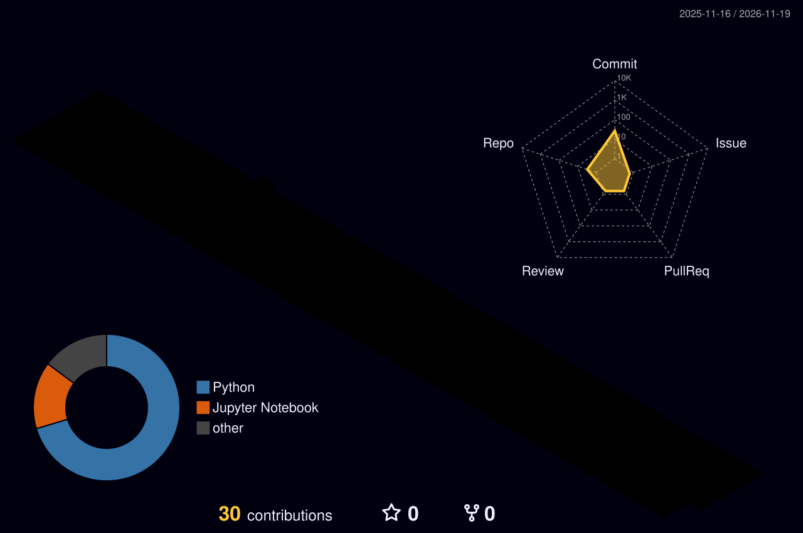

<div align="center">


<a href="https://github.com/selmakoudia03">
  
</a>

<a href="https://github.com/selmakoudia03"></a>
<a href="https://www.linkedin.com/in/VOTRE-SLUG/"></a>


</div>


### `00 // whoami`

```python
from pydantic import BaseModel

class Engineer(BaseModel):
    name: str        = "Selma Koudia"
    role: str        = "AI Engineer · Data Scientist"
    focus: list[str] = ["agentic systems", "NL2SQL on enterprise data",
                        "hybrid GraphRAG", "local LLM inference", "LLM security"]
    principle: str   = "if it isn't traced, validated and evaluated, it isn't in prod"
    open_to: str     = "AI Engineer / Data Scientist roles"

Engineer().model_dump_json(indent=2)  # ✓ validated
```


<div align="center">



<br/>

**Orchestration · Structured outputs · Observability**<br/>
   <img src="https://img.shields.io/badge/Langfuse-0A0A0A?style=for-the-badge&logo=data%3Aimage%2Fsvg%2Bxml%3Bbase64%2CPHN2ZyB3aWR0aD0iNTEyIiBoZWlnaHQ9IjUxMiIgdmlld0JveD0iMCAwIDUxMiA1MTIiIGZpbGw9Im5vbmUiIHhtbG5zPSJodHRwOi8vd3d3LnczLm9yZy8yMDAwL3N2ZyI%2BCjxwYXRoIGQ9Ik0yNTQuNzUgMzAyLjI1TDI4NS4yNSAzMjYuNzVDMjg1LjI1IDMyNi43NSAzMDguNTg3IDMwOS40MTggMzI1Ljc1IDMwNi44NzVDMzQzLjc1IDMwNC4yMDggMzYyLjk1NCAzMTQuMjQ0IDM4MC43NSAzMjYuMjA4QzQwNy42MjkgMzQ0LjI3OSA0MzAuMjUgMzY3LjIwOCA0MzAuMjUgMzY3LjIwOEw0NTYuNzUgMzQxLjIwOEM0NTYuNzUgMzQxLjIwOCAzODMuNjg2IDI2Mi4wNDcgMzI1Ljc1IDI2OS4yMDhDMjg3Ljc1IDI3My45MDUgMjU0Ljc1IDMwMi4yNSAyNTQuNzUgMzAyLjI1WiIgZmlsbD0iI0ZGNUQ1RiIvPgo8cGF0aCBkPSJNODAuMjUgMTUxLjI4Nkw1NS4yNSAxNzguNzg2QzU1LjI1IDE3OC43ODYgMTI0LjkwMiAyNDMuNzg2IDE3OS43NSAyNDMuNzg2QzIwNC43NSAyNDMuNzg2IDIzOS40MTkgMjI0LjIwMSAyNjkuMjUgMTk4Ljc1N0MyODYuMjUgMTg0LjI1NyAzMDUuMjUgMTY3Ljc4NiAzMjQuMjUgMTY3Ljc4NkMzMzcuMDIxIDE2Ny43ODYgMzUzLjg2NiAxNzQuNTUxIDM2OS43NSAxOTIuMzE2QzM2OS43NSAxOTIuMzE2IDM4MC4wMDMgMTg2LjE2OCAzODYuMjUgMTgxLjc1QzM5MS43NCAxNzcuODY4IDM5OS44OTYgMTcxLjI1IDM5OS44OTYgMTcxLjI1QzM3Ny4wNDcgMTQ2Ljg2NCAzNDMuOTk4IDEyOS4wMzggMzI0LjI1IDEzMC43ODZDMjkyLjI1IDEzMC43OSAyNjkuMjUgMTUwLjcxMSAyNDAuNzUgMTczLjc1QzIxMi4yNSAxOTYuNzg5IDIwMC4yNSAyMDYuMjg2IDE3OS43NSAyMDYuMjg2QzE0NS4yNSAyMDYuMjg2IDgwLjI1IDE1MS4yODYgODAuMjUgMTUxLjI4NloiIGZpbGw9IiM0RTlDRkYiLz4KPHBhdGggZD0iTTgwLjI1IDM2MC43NUw1NS4yNSAzMzMuMjVDNTUuMjUgMzMzLjI1IDEyNC45MDIgMjY4LjI1IDE3OS43NSAyNjguMjVDMjA0Ljc1IDI2OC4yNSAyMzkuNDE5IDI4Ny44MzUgMjY5LjI1IDMxMy4yNzlDMjg2LjI1IDMyNy43NzkgMzA1LjI1IDM0NC4yNSAzMjQuMjUgMzQ0LjI1QzMzNy4wODMgMzQ0LjI1IDM1My43OTkgMzM3LjIwNyAzNjkuNzUgMzE5LjI1QzM2OS43NSAzMTkuMjUgMzc5LjMzOSAzMjUuMTYxIDM4NS4yNSAzMjkuMjVDMzkxLjMyOCAzMzMuNDU1IDQwMC4yNSAzNDAuNDA3IDQwMC4yNSAzNDAuNDA3QzM3Ny4zOSAzNjQuOTg3IDM0NC4xIDM4My4wMDcgMzI0LjI1IDM4MS4yNUMyOTIuMjUgMzgxLjI0NiAyNzMuMjUgMzY0LjI4OSAyNDQuNzUgMzQxLjI1QzIxNi4yNSAzMTguMjExIDIwMC4yNSAzMDUuNzUgMTc5Ljc1IDMwNS43NUMxNDUuMjUgMzA1Ljc1IDgwLjI1IDM2MC43NSA4MC4yNSAzNjAuNzVaIiBmaWxsPSIjNEU5Q0ZGIi8%2BCjxwYXRoIGQ9Ik00MDYuMjUgMjEzLjI1QzM5OS43NDUgMjE3Ljc0NiAzODkuMjUgMjI0LjI1IDM4OS4yNSAyMjQuMjVDMzg5LjI1IDIyNC4yNSAzOTUuMjUgMjM3LjI1IDM5NS4yNSAyNTQuNzVDMzk1LjI1IDI3Mi4yNSAzODkuNzUgMjg3LjI1IDM4OS43NSAyODcuMjVDMzg5Ljc1IDI4Ny4yNSAzOTkuMTcyIDI5My4xMzUgNDA1LjI1IDI5Ny4yNUM0MTEuNTY0IDMwMS41MjUgNDIxLjI1IDMwOC43NSA0MjEuMjUgMzA4Ljc1QzQyMS4yNSAzMDguNzUgNDMyLjc1IDI4NC43NSA0MzIuNzUgMjU0Ljc1QzQzMi43NSAyMjQuNzUgNDIxLjI1IDIwMi4yNSA0MjEuMjUgMjAyLjI1QzQyMS4yNSAyMDIuMjUgNDEyLjIyNiAyMDkuMTIgNDA2LjI1IDIxMy4yNVoiIGZpbGw9IiM0RTlDRkYiLz4KPHBhdGggZD0iTTI1Ni4yNSAyMDkuMjVMMjg1LjI1IDE4NS4yNUMyODUuMjUgMTg1LjI1IDMwOC41ODcgMjAyLjA0IDMyNS43NSAyMDQuNTgzQzM0My43NSAyMDcuMjUgMzYyLjk1NCAxOTcuMjE0IDM4MC43NSAxODUuMjVDNDA3LjYyOSAxNjcuMTc5IDQzMC4yNSAxNDQuMjUgNDMwLjI1IDE0NC4yNUw0NTYuNzUgMTcwLjI1QzQ1Ni43NSAxNzAuMjUgMzgzLjY4NiAyNDkuNDExIDMyNS43NSAyNDIuMjVDMjg3Ljc1IDIzNy41NTMgMjU2LjI1IDIwOS4yNSAyNTYuMjUgMjA5LjI1WiIgZmlsbD0iI0ZGNUQ1RiIvPgo8cGF0aCBkPSJNMTg2LjI1NSAxMzAuMjVDMjIzLjc1NSAxMzAuMjUgMjU1LjI1IDE2Mi4yNSAyNTUuMjUgMTYyLjI1QzI1NS4yNSAxNjIuMjUgMjQ2LjQ4NyAxNjkuMTU1IDI0MC43NSAxNzMuNzVDMjM0Ljc3NSAxNzguNTM2IDIyNS4yNSAxODYuMjUgMjI1LjI1IDE4Ni4yNUMyMjUuMjUgMTg2LjI1IDIwOC43NTUgMTY4Ljc1IDE4Ni4yNTUgMTY4Ljc1QzE3Ny4wMjggMTY4Ljc1IDE2NS4wMzkgMTc0LjI5MiAxNTIuMjU1IDE4NS4yNUMxNDIuMzkxIDE5My43MDUgMTMyLjEyOSAyMDQuMjE2IDEyNS4yNTUgMjE3LjI1QzExOS4zMSAyMjguNTIgMTE2LjA2OCAyNDEuODAyIDExNS43NTUgMjU1Ljc1QzExNS4zNjEgMjczLjI2OSAxMjEuNTcxIDI5MS42MzQgMTMxLjc1NSAzMDYuMjVDMTM4LjU4IDMxNi4wNDYgMTQ2LjcyNiAzMjMuNDE4IDE1NS4yNTUgMzI5Ljc1QzE2Ni4zMjMgMzM3Ljk2OCAxNzcuODY1IDM0My43NSAxODYuMjU1IDM0My43NUMxOTUuMjE3IDM0My43NSAyMDMuMjc0IDM0MC42MzUgMjA5LjI1NSAzMzcuNzVDMjE4Ljc1NSAzMzIuMjUgMjI2LjI1IDMyNS43NSAyMjYuMjUgMzI1Ljc1TDI1NS43NSAzNTAuMjVDMjU1Ljc1IDM1MC4yNSAyNDMuNzUgMzYyLjI1IDIyNy4yNTUgMzcxLjI1QzIxNi41OTUgMzc2LjUwNyAyMDIuODk1IDM4MS43NSAxODYuMjU1IDM4MS43NUMxNjkuNjI2IDM4MS43NSAxNTAuMzE1IDM3Mi45MTUgMTMyLjI1NSAzNTkuMjVDMTIwLjU3OSAzNTAuNDE2IDEwOS4xMzUgMzM5Ljk0OCAxMDAuMjU1IDMyNy4yNUM4NS43MDA1IDMwNi40MzggNzguMjAwNCAyODEuMTE4IDc4LjI1MDIgMjU1Ljc1Qzc4LjMwMDggMjMwLjA2NSA4Ni41ODIzIDIwNC42MjUgMTAxLjI1NSAxODMuNzVDMTI0LjI1NSAxNTMuNzUgMTU4LjI3MyAxMzAuMjUgMTg2LjI1NSAxMzAuMjVaIiBmaWxsPSIjRkY1RDVGIi8%2BCjwvc3ZnPgo%3D" alt="Langfuse"/>

**Inference · Quantization · Deep Learning**<br/>
    

**Retrieval · Data · Serving**<br/>
      

</div>


<div align="center">



</div>

<details>
<summary><b>▸ how the pipeline works (click)</b></summary>

| Stage | What happens | Tooling |
|---|---|---|
| Guardrails | prompt-injection & PII scan before anything touches a model | custom rules + LLM judge |
| Router | `StateGraph` classifies intent and dispatches to the right sub-graph | LangGraph |
| Retrieval | hybrid graph + vector retrieval over docs and the data catalog | LightRAG · FAISS |
| Text-to-SQL | schema linking → generation → AST validation before execution | sqlglot |
| Validation | every model output is parsed into a typed contract | Pydantic v2 |
| Inference | local, quantized models behind an OpenAI-compatible API | vLLM · llama.cpp |
| Tracing | spans, latency, cost and eval scores on every run | Langfuse |

</details>


### `03 // DEMO`

https://github.com/user-attachments/assets/dd76f7a0-a053-4cc4-aff0-b654018002b9


### `04 // FEATURED BUILDS`

<table>
<tr>
<td width="33%" valign="top">

**🧠 NL2SQL Catalog Agent**<br/>
<sub>LangGraph · sqlglot · Pydantic</sub>

Answers questions about tables & columns, writes SQL, validates the AST, explains the result.

<a href="https://github.com/selmakoudia03">→ repo</a>
</td>
<td width="33%" valign="top">

**🕸️ Hybrid GraphRAG**<br/>
<sub>LightRAG · FAISS · local LLM</sub>

Knowledge-graph + vector retrieval for grounded answers over enterprise docs.

<a href="https://github.com/selmakoudia03">→ repo</a>
</td>
<td width="33%" valign="top">

**⚡ Local Inference Lab**<br/>
<sub>vLLM · llama.cpp · Langfuse</sub>

Serving & benchmarking quantized models (AWQ / GGUF) with full tracing.

<a href="https://github.com/selmakoudia03">→ repo</a>
</td>
</tr>
</table>


### `05 // TELEMETRY`

<div align="center">




<picture>
  <source media="(prefers-color-scheme: dark)" srcset="https://raw.githubusercontent.com/selmakoudia03/selmakoudia03/output/github-snake-dark.svg"/>
  
</picture>

</div>


